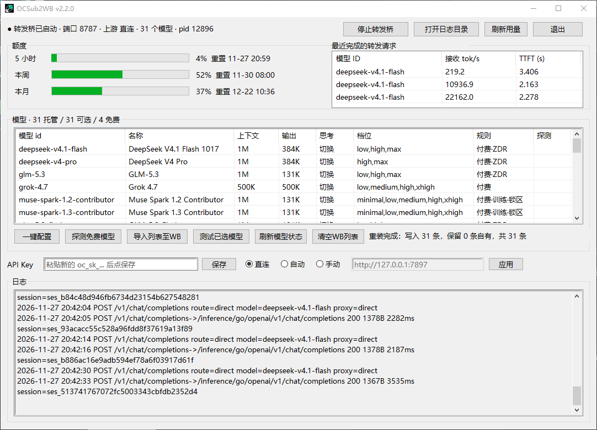

<div align="center">
  
  <h1>OCSub2WB</h1>
  <p>在 Windows 上，把 WorkBuddy 接到你的 OpenCode Go 订阅。</p>
  <p>
    <a href="https://github.com/869Nitro/OCSub2WB/releases/latest"><strong>下载 Windows x64 便携包</strong></a>
    &nbsp;·&nbsp; <a href="#快速开始">快速开始</a>
    &nbsp;·&nbsp; <a href="#常见问题">常见问题</a>
  </p>
</div>

## 快速开始

准备好 WorkBuddy 和自己的 [OpenCode Go API Key](https://opencode.ai/docs/console/go/)。面板可以使用 WorkBuddy 自带的 Python。WorkBuddy **5.11.3.43806934-ecace0f7** 已通过转发验证。

1. **打开 WorkBuddy 并登录。**
2. **下载并解压 ZIP。** 打开其中的 `OCSub2WB.exe`。两个 `.py` 文件和 EXE 放在同一目录。
3. **点「启动转发桥」。** 等面板显示转发桥已启动，粘贴 OpenCode Go Key，点「保存」。如果访问 OpenCode 需要本机代理，先设置[上游代理](#上游代理)。
4. **点「一键配置」。** 回到 WorkBuddy，在「设置 → 模型」选择 OpenCode 分组里的模型，发一条消息。

一键配置会填好接口地址。想先测某个模型，可以在 OCSub2WB 中选中它，再点「测试已选模型」。ZIP 的 SHA-256 校验文件也在[发布页](https://github.com/869Nitro/OCSub2WB/releases)。

<p align="center">
  
</p>

## 系统还原后

重新安装并登录 WorkBuddy。便携目录还在的话，打开 OCSub2WB，点「启动转发桥」和「一键配置」。`.env` 还在就会沿用原来的 Key 和代理设置。便携目录或 `.env` 丢了，重新解压或填一次 Key 即可。

## 上游代理

WorkBuddy 连接转发桥的地址是 `http://127.0.0.1:8787/v1`。面板里的上游代理用于转发桥访问 OpenCode Go。用 Clash 等本机代理时，填它实际提供的 HTTP 地址，例如 `http://127.0.0.1:7897`，点「应用」。

| 模式 | 模型请求走哪里 |
| --- | --- |
| 直连 | 直接访问 OpenCode Go |
| 自动 | 标记为锁区的模型走上游代理，其余模型直连 |
| 手动 | 所有模型请求都走上游代理 |

## 日常操作

| 操作 | 用途 |
| --- | --- |
| 一键配置 | 从目录重建托管模型，包含免费模型。已有自定义模型会保留。 |
| 探测免费模型 | 查看当前工作区能用哪些免费模型。 |
| 导入列表至WB | 导入付费聊天模型和刚刚探测成功的免费模型。 |
| 测试已选模型 | 单独测一个模型的普通对话和流式对话，最多发两次请求。 |
| 刷新模型状态 | 更新模型表和导入标记。 |
| 清空WB列表 | 备份后移除托管模型。 |

顶部的「刷新用量」可手动更新额度。额度区右侧显示最近 3 条成功完成的模型请求，包括模型 ID、输出速度和 TTFT。并发请求按完成顺序更新。模型 ID 过长时以省略号截断，数字列保留完整数值。

- **TTFT (s)** 是转发桥发起上游请求到收到首段非思考输出的秒数。正文和工具调用内容都算输出。
- **tok/s** 估算首段到末段输出之间的生成速度，使用扣除思考后的输出 token 数。首段等待、流末用量事件和结束标记不计入耗时。只有一段输出、上游未提供用量或无法区分思考用量时，该项显示「—」。
- 非流式响应会显示模型 ID，两项流式指标显示「—」。模型自测不参与统计，转发桥重启后清空。

拖动窗口边缘可调整大小，最小尺寸为面板的默认大小。点右上角的最大化按钮可铺满 Windows 桌面工作区，再点一次可还原窗口。

点窗口右上角的 × 会把面板收到系统托盘。要一起关闭面板和转发桥，点「退出并停止转发桥」。

## 常见问题

| 现象 | 怎么处理 |
| --- | --- |
| 提示找不到 Python 或脚本 | 先打开 WorkBuddy。确认两个 .py 文件都在 EXE 旁边，缺了就重新解压。 |
| 提示 8787 已被占用 | 关闭占用该端口的程序，再启动转发桥。 |
| WorkBuddy 无法连接 | 确认转发桥已启动，重新点「一键配置」，再在 WorkBuddy 里选一次模型。 |
| Key 保存失败或收到 403 | 检查 Key 所属的工作区、订阅和区域设置。如果访问 OpenCode 需要代理，确认面板中的上游代理可用。 |
| 免费模型要求 opt-in | 到 OpenCode 工作区查看该模型的训练选项。只有接受对应的数据规则时才开启。 |
| 面板提示配置损坏 | 在面板确认从备份恢复，再点「一键配置」。原文件会以 `models.json.corrupt.<时间>` 保留。 |

排查对话问题时，可以在面板打开日志。日志记录请求的路由、状态码和耗时。

## Key 和请求发到哪里

Key 以明文保存在便携目录的 `.env` 与 WorkBuddy 的自定义模型条目中。模型备份位于 `cache/backup/`，也可能包含 Key。分享配置目录前先移除这些文件。

对话和 Key 由转发桥发给 OpenCode Go。训练、留存与区域规则取决于工作区设置和所用模型。详见 [OpenCode Go 的隐私说明](https://opencode.ai/docs/console/go/#privacy)。

<details>
<summary>配置文件和命令行</summary>

| 位置 | 内容 |
| --- | --- |
| 便携目录的 `.env` | Key、上游代理和模型名前缀。参考 [`.env.example`](./.env.example)。 |
| `%USERPROFILE%\.workbuddy\models.json` | WorkBuddy 的自定义模型列表。 |
| 便携目录的 `cache/` | 日志、备份、控制令牌和转发桥 PID。 |

写模型配置前会先备份。备份失败时保留原配置。外部地址的自定义模型会保留，同一模型 ID 已被它占用时也保留原条目。

使用 Python 脚本时，`--port` 可以选择监听端口。一键配置会写入对应端口。Windows 面板固定使用 `8787`。

模型名称默认带 [OC] 或 [OC-FREE]，模型 ID 取自 OpenCode Go 目录。若在旧 .env 中设置过模型名前缀或代理，转发桥会继续读入这些值。

</details>

<details>
<summary>从源码构建</summary>

准备 MinGW-w64 和 Python 3.10 或更新版本。让 g++ 和 windres 可从 PATH 找到，或设置 MINGW 为工具链的 bin 目录。

```cmd
panel\build.bat --ci
python -B -m unittest discover -s tests
```

GitHub Actions 在 Windows 上运行离线测试并构建便携包。标签构建同时生成 ZIP 与 SHA-256，供 Release 草稿使用。源码和工作流见[项目仓库](https://github.com/869Nitro/OCSub2WB)。

</details>

## 许可

OCSub2WB 是独立项目。自有代码和文档采用 [MIT](./LICENSE)。便携包中的运行库见[第三方许可](./THIRD-PARTY-NOTICES.md)。
